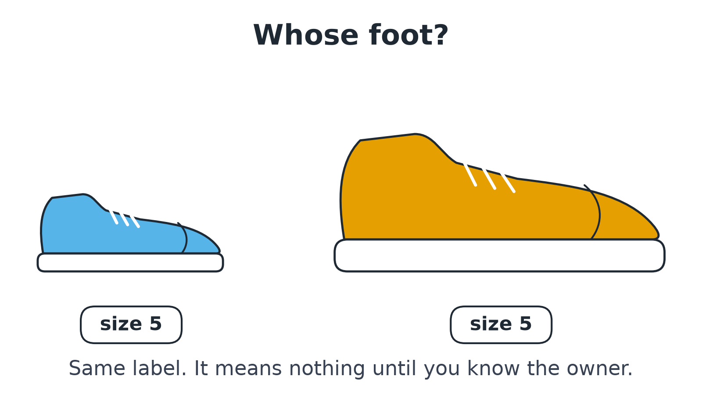
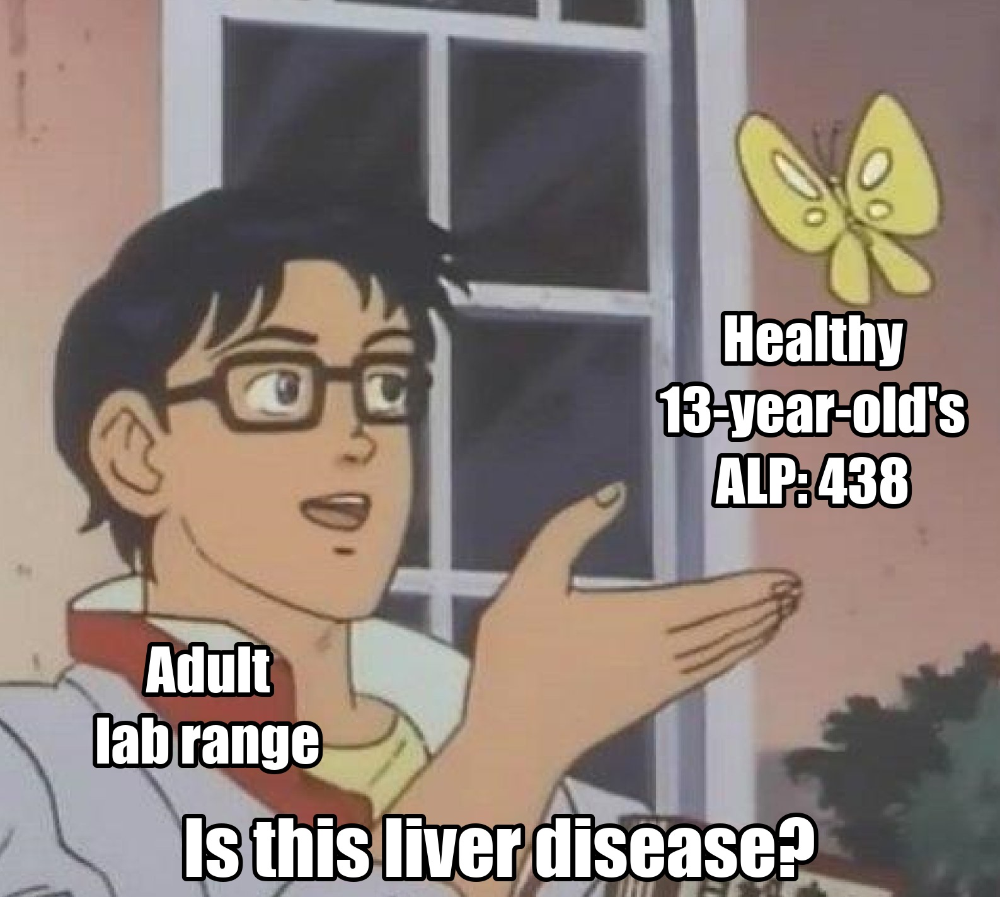
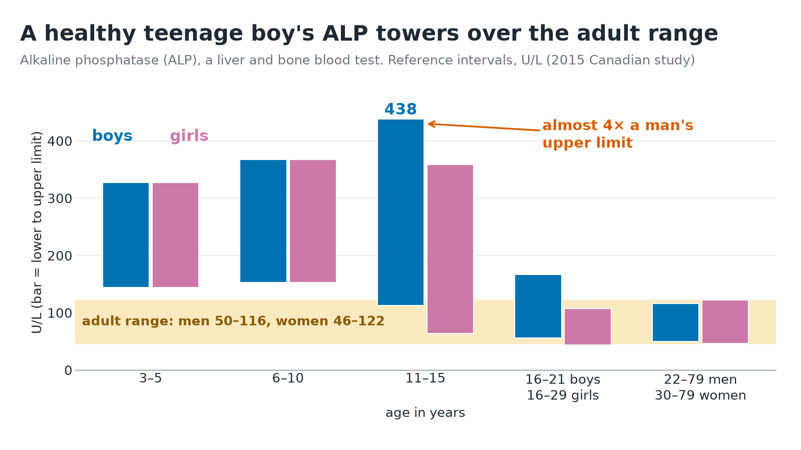
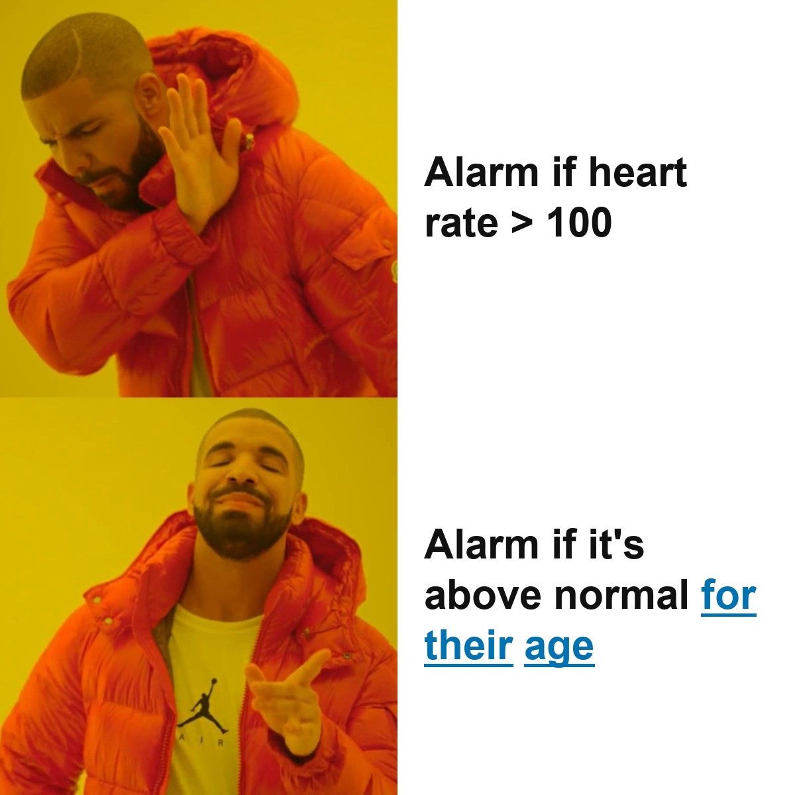

A heart rate of 150 beats per minute.

If it belongs to a one-month-old baby, it's an ordinary Tuesday. A [large review of healthy children](https://pmc.ncbi.nlm.nih.gov/articles/PMC3789232/) puts the typical heart rate at that age at about 145.

If it belongs to a 40-year-old sitting on the sofa, it's a different story. The usual adult resting range is 60 to 100, and [Mayo Clinic](https://www.mayoclinic.org/healthy-lifestyle/fitness/expert-answers/heart-rate/faq-20057979) suggests talking to a health professional if yours is regularly above 100.

Same number. Two completely different meanings.

Now picture that 150 landing in your model. What does the model do with it? (By "model" I mean any software that reads patient data and decides what looks wrong.)

## Whose foot is it?

Walk into a shoe shop and ask for a size 5. Before anyone fetches a box, you'll get a question back: who's it for?

That's because "size 5" is two different shoes. There's a toddler's size 5 and an adult's size 5, and one would fit inside the other with room to spare.

{: style="display:block; margin:0 auto; width:100%; max-width:680px;"}
_The same label on two shoes. "Size 5" only means something once you know whose foot it is._
{: style="text-align:center; font-size:0.9em;"}

Clinical numbers work the same way. A heart rate, a blood test result and a drug dose are all labels on a box. You can't read any of them until you know whose foot they belong to.

That's the idea of this whole post in one line: **a number needs an owner.** Doctors who look after children have an older, shorter version: children aren't small adults.

Hold on to the shoes. They'll come back for blood tests, and again for medicines.

## Normal moves as children grow

A child's "normal" shifts a lot, and fast.

The [review from the opening](https://pmc.ncbi.nlm.nih.gov/articles/PMC3789232/) pooled heart-rate data on about 143,000 healthy children and charted the normal range from birth to 18. Around one month old, the median (middle) heart rate is about 145 beats a minute. By 15 to 18, it's about 73.

So 150 sits comfortably inside a young baby's normal range, and far above the top of a teenager's.

![Step chart of heart rate by age band from birth to 18 years. A blue shaded band shows the normal range for healthy children, labelled "lowest normal" and "highest normal" (the 1st and 99th centiles), and a heavy line shows the median. The x-axis is labelled at Birth, 3 months, 1, 2, 6, 12 and 18 years. Both start high in the first months (median 143 and 99th centile 181 at 0 to 3 months) and fall to a median of 73 and a 99th centile of 104 at 15 to 18 years. A shaded band marks the adult resting range of 60 to 100. A red dot at 150 sits inside the 0 to 3 month range, above the adult band.](/assets/img/blog/children-arent-small-adults/02-heart-rate-by-age.png){: style="display:block; margin:0 auto; width:100%; max-width:680px;"}
_Median heart rate and its normal range by age band, from the 2011 Lancet review, against the adult resting range from [Mayo Clinic](https://www.mayoclinic.org/healthy-lifestyle/fitness/expert-answers/heart-rate/faq-20057979). The 150 is a hypothetical reading._
{: style="text-align:center; font-size:0.9em;"}

The part I find most interesting is that **even the guideline age bands were off.** In fairness, those bands were written for resuscitation and triage, and the review's authors thought many were probably set by clinical consensus rather than measured on healthy children.

Still, when the team checked the normal ranges printed in clinical guidelines against their data, they found "marked disagreement". Many limits were too loose. Some were so tight that, at some ages, more than half of healthy children would have counted as abnormal.

One life-support guideline at the time put the top of normal for ages 2 to 10 at 140. For most of that age span, that's above the top of the real normal range.

If you build models, this should feel familiar. A guideline table is a model of "normal" too. This review was, in effect, a big validation set: fresh data the table had never been tested on.

## The "abnormal" blood test that just means growing

A healthy teenage boy can have a blood test result almost four times a man's upper limit, and be perfectly fine.

The test is ALP, short for alkaline phosphatase. It's an enzyme, a protein that speeds up chemical reactions, found in many tissues but especially the liver and bones. Doctors use it to check on both ([MedlinePlus](https://medlineplus.gov/lab-tests/alkaline-phosphatase/)). Growing bone makes a lot of it, so ALP runs highest in childhood and puberty ([StatPearls](https://www.ncbi.nlm.nih.gov/books/NBK459201/)).

A [2015 Canadian study](https://doi.org/10.1373/clinchem.2015.240515) measured ALP in about 12,000 people aged 3 to 79, on the same lab machine for every age, so differences between machines aren't muddying the comparison. The top of the healthy range was 438 units per litre for boys aged 11 to 15, and 116 for men.

{: style="display:block; margin:0 auto; width:100%; max-width:420px;"}
{: style="text-align:center; font-size:0.9em;"}

Run his result through a rule built on adult ranges and it looks like his liver is in trouble. It isn't. His bones are growing.

{: style="display:block; margin:0 auto; width:100%; max-width:680px;"}
_Healthy reference ranges for ALP by age and sex, from the [2015 Canadian study](https://doi.org/10.1373/clinchem.2015.240515). A teenage boy's upper limit is almost 4 times a man's._
{: style="text-align:center; font-size:0.9em;"}

So when a model sees an ALP of 300, ask the shoe-shop question first: whose foot?

## Smaller isn't the same as younger

A wrong normal range gives you false alarms and missed problems. With medicines, getting the owner wrong can do direct harm.

[In 1959, doctors reported](https://doi.org/10.1001/archpedi.1959.02070010763001) that babies given large amounts of the antibiotic chloramphenicol were collapsing as their circulation failed, and some died. [A study of premature babies that year](https://doi.org/10.1056/NEJM195912242612604) found more deaths among those given the drug. The condition became known as grey baby syndrome, and [one of its signs](https://doi.org/10.3389/fped.2025.1733059) is ashen-grey skin.

The problem wasn't just that the babies were small. A newborn's liver [can't yet do much of the chemical work](https://doi.org/10.3389/fped.2025.1733059) that lets the body get rid of this drug, and [newborn kidneys clear it more slowly too](https://doi.org/10.1056/NEJM196004212621601). So each dose landed on top of what was left of the last one, and the drug built up to toxic levels.

Today, children's doses are commonly worked out per kilogram of body weight. That handles size, but not maturity: a [2026 review](https://doi.org/10.3390/ph19071090) warns that simply scaling adult doses by weight misses how a baby's drug-processing enzymes and organs mature.

You can't cut an adult shoe down to fit a toddler, and you can't simply scale down an adult dose either. If your model sees doses, it needs the child's weight and age right next to them.

## Where adult rules meet children

Clinicians already handle this on paper. Children's early-warning scores, the bedside checklists that flag a child who is getting worse, work in age bands, though [some widely used ones refer to the same guideline ranges](https://pmc.ncbi.nlm.nih.gov/articles/PMC3789232/) the review found were off. A model has to be told, or has to see enough children to learn it.

The trouble starts where adult rules and models meet children without that context: an emergency department that sees every age, or a model trained mostly on adults. That's where the 150 lands.

Take an adult-style rule: alert if heart rate is above 100. Until about age 4, the median heart rate is above 100, so it would ring for plenty of healthy children (see the chart above). It also misses the opposite case. By the adult range of 60 to 100, a two-month-old at 70 looks calm. In fact, 70 is far below the lowest normal for that age (about 107), which makes it a red flag.

Now give the rule the patient's age: alert only above the top of the normal range for that age (roughly the 99th centile: the value only about 1 in 100 healthy children that age go above).

{: style="display:block; margin:0 auto; width:100%; max-width:680px;"}
_Five made-up patients, two rules. The age-aware rule uses each age band's top of normal from the 2011 review's appendix. Once the rule knows the age, three of the five alerts go away._
{: style="text-align:center; font-size:0.9em;"}

That helps, but it doesn't finish the job. It will still flag some healthy children, so you'd measure its alert rate in the place it's going to run. And age is only one thing that moves a heart rate: fever and anxiety can push it up too.

In a [2013 study of children in hospital](https://doi.org/10.1542/peds.2012-2443), up to 54% of heart-rate readings fell outside textbook normal ranges. Alarm on all of those and you get alarm fatigue: so many alerts that people stop hearing them.

A monitor takes a lot of readings, so even a small false-alarm rate adds up fast. For borderline readings, better rules look at whether the reading persists, which way it's trending and what the other signs say, while a truly dangerous value still raises the alarm straight away.

{: style="display:block; margin:0 auto; width:100%; max-width:420px;"}
{: style="text-align:center; font-size:0.9em;"}

For a model, there are two fixes worth trying:

1. **Give the model the owner.** Feed in age, plus weight and sex where they matter, next to each value. Then it can learn that 150 means different things at different ages.
2. **Translate the number before the model sees it.** Compare each value with healthy children of the same age, and pass on how unusual it is. Not "150", but "near the middle for a one-month-old".

The second is how clinicians already read growth: a child's height against other children the same age.

Age is the clearest missing context, but not the only one: weight, sex and [how early a baby was born](https://doi.org/10.3390/ph19071090) matter too. A number in a health record rarely carries all the context it needs.

---

## For the engineers: giving the model the owner

_Skippable. If you don't build models, [jump to the takeaway](#the-takeaway)._

### Three options

(a) and (b) are the story's two fixes; (c) is the tempting one.

**(a) Age as a feature.** Easiest: pass age in and hope the model learns the interactions ("150 is ordinary at one month, alarming at 40"). Trees and neural networks can, if every age is well covered; a linear model can't without interaction terms. If children are a thin slice of your data, that's a lot to ask.

**(b) Normalise for age first.** Turn each raw value into a z-score or centile (percentile) against healthy children of the same age and sex. You borrow knowledge from a large healthy reference instead of asking the model to rediscover it from your smaller, sicker cohort. The catches: you inherit the reference's assumptions, and lose the number's absolute size. Keep the raw value as a feature too, and clip extreme scores.

**(c) One model per age band.** Neat on a whiteboard. In practice each band gets less data, you inherit cliffs at the band edges, and you maintain several models.

With small data, (b) plus age and the raw value is a sensible first try.

### Bins have cliffs; curves don't

The heart-rate review drew smooth centile curves using kernel regression, a smoothing method. Bins create cliffs: a baby who is 364 days old and one who is 366 days old get different "normals", although their hearts have never heard of birthdays.

{: style="display:block; margin:0 auto; width:100%; max-width:680px;"}
_Age bins put a cliff at every edge, so two babies two days apart get different "normals"; a smooth curve doesn't. The shape is illustrative, not real reference data._
{: style="text-align:center; font-size:0.9em;"}

Published tables are still banded, even over smooth curves. The review's appendix lists cut-offs per age band, which is why our heart-rate chart and five-patient figure use bands too.

Lab bins also differ by test: [CALIPER needed seven age groups for ALP but only three for ALT](https://pmc.ncbi.nlm.nih.gov/articles/PMC5387699/). Don't copy one test's bins onto another.

### From a reference table to a score

```python
import numpy as np

# ILLUSTRATIVE NUMBERS ONLY. These are NOT clinical reference values.
# Replace them with a published reference built from healthy children
# (in real life: one table per sex, and per measurement method).
REF_AGE_DAYS = np.array([0, 30, 365, 730, 3650, 6570])
REF_MEDIAN   = np.array([130, 140, 120, 110, 90, 80])   # made up
REF_SD       = np.array([16, 16, 15, 14, 12, 11])       # made up

def age_z(value, age_days):
    """How unusual is this value for a healthy child of this age?"""
    median = np.interp(age_days, REF_AGE_DAYS, REF_MEDIAN)
    sd = np.interp(age_days, REF_AGE_DAYS, REF_SD)
    return (value - median) / sd

print(age_z(150, age_days=30))    # 0.625 with these toy numbers: unremarkable
print(age_z(150, age_days=6570))  # about 6.4: wildly unusual
```

The review's [web appendix](https://pmc.ncbi.nlm.nih.gov/articles/PMC3789232/) gives centile cut-offs per band, not a median and SD, so `age_z` won't take it directly. Interpolate between the published centiles for an approximate percentile, or fit a smooth model such as Cole and Green's [LMS method](https://doi.org/10.1002/sim.4780111005) (curves over age for the median, spread and skew).

Skew matters: for boys aged 11 to 15 in the Canadian study, the ALP median (247) sits closer to the bottom of the range (113) than the top (438), so a symmetric z-score misleads in the tails. And `np.interp` quietly clamps ages outside the table to the nearest edge.

Also check what "upper limit" means: the heart-rate charts use the 1st to 99th centile, and lab reference intervals may use a different cut. Read the methods before you compare them.

### Gotchas

- **Pick the reference for your question.** "Unusual for this age?" needs a healthy reference. "Page a nurse?" may need centiles from children in hospital, as the [2013 study](https://doi.org/10.1542/peds.2012-2443) built.
- **Evaluate per age band, not just overall.** A model that's great on adults and poor on infants can still post a fine overall AUROC. Check alerts against real outcomes, band by band.
- **How you measure shifts "normal".** In the heart-rate review, community readings ran higher than clinic ones, ECG higher than hand counts, and newer studies higher than older ones. If your reference and data were measured differently, your scores inherit the gap.
- **Ranges belong to a lab, and to a sex.** ALP ranges depend on the lab and method ([StatPearls](https://www.ncbi.nlm.nih.gov/books/NBK459201/)), and in the Canadian data girls' ALP starts falling around 11, boys' around 16. Normalise against the lab's own range for the child's age and sex.
- **Age in days, at each measurement.** "Age 0" lumps a newborn with an 11-month-old, yet the median heart rate climbs from 127 to 145 in the first month. Compute age at each reading, not admission; check de-identified extracts didn't shrink it to whole years; and for babies born early, check whether the reference expects corrected age (age minus weeks born early).
- **Doses need a weight.** Check it exists, is recent, and is in the units you think: kilograms, pounds, or grams for newborns.
- **Some extremes are real.** Children can have temporary ALP spikes of up to 30 times the upper limit, called transient hyperphosphatasemia, usually without symptoms ([StatPearls](https://www.ncbi.nlm.nih.gov/books/NBK459201/)). A very high value still needs its cause checked, so don't let an outlier filter delete it as an error, and don't hard-code it as disease either.

---

## The takeaway

A number means nothing until you know whose it is.

Age just happens to be the easiest place to see it. Before you trust a threshold or a feature in a clinical model, ask the shoe-shop question. Whose foot is this, and what else does the number leave out?

Next time: **Your model has never met a child.** What happens when a model trained on adults is deployed on children.

## Further reading

- [The 2011 Lancet review of children's heart and breathing rates](https://pmc.ncbi.nlm.nih.gov/articles/PMC3789232/) (open access): the centile charts, and how far the guideline ranges were off.
- [Heart-rate centiles for children in hospital](https://doi.org/10.1542/peds.2012-2443) (Pediatrics, 2013): why the right reference depends on the question.
- [CALIPER's children's reference ranges for 40 blood markers](https://doi.org/10.1373/clinchem.2011.177741) (Clinical Chemistry, 2012).
- [The Canadian study of 24 blood markers from age 3 to 79](https://doi.org/10.1373/clinchem.2015.240515) (Clinical Chemistry, 2015): where the ALP numbers come from.
- [Developmental pharmacology in infants and children](https://doi.org/10.1056/NEJMra035092) (New England Journal of Medicine, 2003): why children's bodies handle drugs differently.
